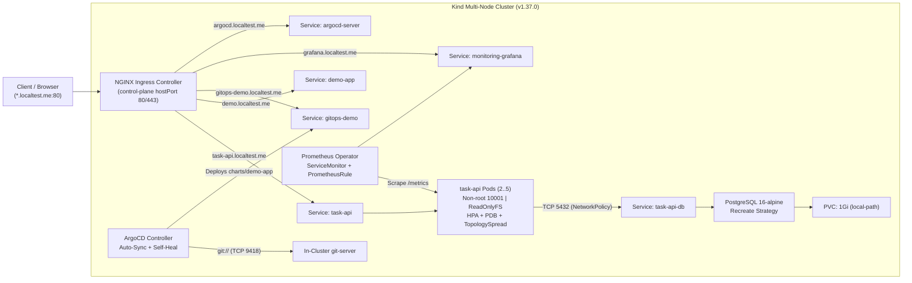

# Local Kubernetes Platform & GitOps Stack (Kind)

A production-patterned local Kubernetes platform built on a **3-node Kind cluster**, combining **NGINX Ingress**, **Metrics Server + HPA**, custom **Helm charts**, a **hardened two-tier Flask + PostgreSQL microservice**, **Prometheus + Grafana** observability with alerting rules, **ArgoCD** GitOps, and an automated **GitHub Actions CI** pipeline.

---

## Architecture



---

## Engineering & Security Highlights

- **Container & Pod Hardening (`task-api`)**:
  - Multi-worker Gunicorn image runs as unprivileged UID `10001` with `PYTHONDONTWRITEBYTECODE=1` and `--worker-tmp-dir /tmp`.
  - Pod `securityContext` enforces `runAsNonRoot: true`, `RuntimeDefault` seccomp profile, `readOnlyRootFilesystem: true` (with `/tmp` `emptyDir`), `allowPrivilegeEscalation: false`, `capabilities.drop: ["ALL"]`, and `automountServiceAccountToken: false`.
- **High Availability & Traffic Isolation**:
  - `PodDisruptionBudget` (`minAvailable: 1`), `HorizontalPodAutoscaler` (`autoscaling/v2`, `2`–`5` replicas), and `topologySpreadConstraints` across worker nodes.
  - `NetworkPolicy` isolates PostgreSQL (`5432/TCP` only from `task-api` pods) and restricts `task-api` (`5000/TCP` only from `ingress-nginx` and `monitoring`).
- **Observability & Alerting**:
  - Exposes custom Prometheus metrics (`task_api_http_requests_total`, `task_api_http_request_duration_seconds` histogram, `task_api_tasks_count` gauge) scraped via `ServiceMonitor`.
  - Includes `PrometheusRule` SLO alerts (`TaskApiHigh5xxErrorRate`, `TaskApiHighP95Latency`) guarded by `.Capabilities.APIVersions.Has "monitoring.coreos.com/v1"`.
- **GitOps & Secret Hygiene**:
  - ArgoCD continuously reconciles `gitops-demo-app` with `prune: true` and `selfHeal: true`.
  - Tracked Helm values never store credentials; `postgres-secret.yaml` enforces `required` on `postgres.password` at deploy time.
- **Automated CI (`.github/workflows/ci.yml`)**:
  - Runs `ruff` linting, `pytest` unit tests, `helm lint`, `kubeconform` strict schema validation, `hadolint` Dockerfile checks, and Docker Buildx verification on every push and PR.

---

## Design Decisions & Trade-offs

| Decision | Rationale & Production Equivalent |
|---|---|
| **Ingress pinned to `control-plane` (`ingress-ready=true`)** | Kind maps host ports `80`/`443` onto the control-plane container; pinning `ingress-nginx-controller` ensures direct `localhost` routing without `NodePort` offsets. In cloud clusters (EKS/GKE), a `LoadBalancer` Service replaces hostPort mapping. |
| **PostgreSQL advisory lock in `ensure_db()`** | Multiple Gunicorn workers and pod replicas starting concurrently against a fresh DB race on `CREATE TABLE IF NOT EXISTS` (`pg_type_typname_nsp_index`). Acquiring `pg_advisory_lock(424242)` serializes schema bootstrap; in larger apps, a dedicated migration Job (Alembic/Flyway) is preferred. |
| **`Recreate` deployment strategy for PostgreSQL** | `local-path` PVCs are `ReadWriteOnce` (`RWO`). A `RollingUpdate` deadlocks waiting to attach the volume to a new pod on another node; `Recreate` releases the volume cleanly before starting the replacement pod. |
| **`--kubelet-insecure-tls` on Metrics Server** | Kind's kubelet self-signed serving certs lack IP SANs. Skipping TLS verification unblocks `kubectl top` and HPA locally; production clusters should enable `serverTLSBootstrap: true` with signed kubelet certs. |
| **In-cluster `git-server` for ArgoCD** | Allows fully offline/self-contained GitOps reconciliation inside Kind using `git://` without requiring external webhook tunnels or GitHub PATs inside the local cluster. |

---

## Repository Structure

```text
.
├── .github/workflows/ci.yml              # CI: Ruff, Pytest, Helm lint, kubeconform, Hadolint, Docker build
├── app/
│   ├── app.py                            # Flask REST API + Prometheus metrics + pg_advisory_lock
│   ├── Dockerfile                        # Non-root Python 3.12 Alpine image (UID 10001)
│   ├── requirements.txt                  # Pinned runtime dependencies
│   ├── requirements-dev.txt              # Lint/test dependencies (ruff, pytest)
│   └── tests/test_app.py                 # Unit tests with mocked PostgreSQL connections
├── charts/
│   ├── demo-app/                         # Reusable Helm chart (ConfigMap, Deploy, Svc, Ingress, HPA)
│   └── task-api/                         # Hardened 2-tier chart (API, Postgres, PVC, HPA, PDB, NetPol, Alerts)
├── gitops/
│   ├── git-server.yaml                   # In-cluster Git daemon for local ArgoCD syncing
│   └── gitops-demo-app.yaml              # ArgoCD Application (auto-sync + self-heal)
├── manifests/
│   ├── hpa-test-nginx.yaml               # HPA for test-nginx
│   ├── test-nginx-ingress.yaml           # Ingress for test-nginx
│   ├── test-nginx.yaml                   # Phase 1 Nginx Deployment & Service
│   └── platform/
│       ├── argocd-values.yaml            # Helm values for ArgoCD
│       ├── ingress-node-selector-patch.yaml
│       ├── metrics-server.yaml           # Metrics Server manifest (--kubelet-insecure-tls)
│       └── monitoring-values.yaml        # Helm values for kube-prometheus-stack
├── scripts/
│   └── verify.ps1                        # End-to-end cluster & HTTP smoke test script
├── Makefile                              # Standard dev/ops automation targets
├── kind-config.yaml                      # 3-node Kind cluster definition
├── devopsproject2.md                     # Detailed phase guide & command cheat sheet
├── .gitignore
└── README.md
```

---

## Prerequisites

- **Docker Desktop** (running)
- **Kind** (`v0.33.0+`)
- **kubectl** (`v1.36.1+`)
- **Helm** (`v4.3.0+`)
- **Python** (`3.12+`, optional for local unit tests)

---

## Quick Start

### 1. Provision Cluster & Baseline Workload
```powershell
kind create cluster --name dev-cluster --config kind-config.yaml
kubectl apply -f manifests/test-nginx.yaml
```

### 2. Install Platform Core (Ingress, Metrics Server, Helm Chart)
```powershell
kubectl apply -f https://raw.githubusercontent.com/kubernetes/ingress-nginx/main/deploy/static/provider/kind/deploy.yaml
kubectl patch deployment ingress-nginx-controller -n ingress-nginx --patch-file manifests/platform/ingress-node-selector-patch.yaml

kubectl apply -f manifests/platform/metrics-server.yaml
kubectl apply -f manifests/test-nginx-ingress.yaml
kubectl apply -f manifests/hpa-test-nginx.yaml

helm upgrade --install demo-app ./charts/demo-app --wait
```

### 3. Deploy Microservice, Observability & GitOps
```powershell
# Build and load hardened Task API image
docker build -t task-api:1.0.2 ./app
kind load docker-image task-api:1.0.2 --name dev-cluster

# Add Helm repositories
helm repo add prometheus-community https://prometheus-community.github.io/helm-charts
helm repo add argo https://argoproj.github.io/argo-helm
helm repo update

# Monitoring stack (Prometheus + Grafana)
helm upgrade --install monitoring prometheus-community/kube-prometheus-stack `
  --namespace monitoring --create-namespace -f manifests/platform/monitoring-values.yaml --wait

# Two-tier microservice (explicit DB password required)
helm upgrade --install task-api ./charts/task-api --set postgres.password=<your-db-password> --wait

# ArgoCD + GitOps Application
helm upgrade --install argocd argo/argo-cd `
  --namespace argocd --create-namespace -f manifests/platform/argocd-values.yaml --wait
kubectl apply -f gitops/git-server.yaml
kubectl apply -f gitops/gitops-demo-app.yaml
```

---

## Verification & Runbook

Run the smoke-test script to verify cluster nodes, Helm releases, ArgoCD sync state, and all Ingress routes:
```powershell
./scripts/verify.ps1
```

### Live Endpoints (`.localtest.me` -> `127.0.0.1`)

| Service | URL | Access / Notes |
|---|---|---|
| **Task API** | `http://task-api.localtest.me/` | Endpoints: `/healthz`, `/tasks`, `/metrics` |
| **Grafana** | `http://grafana.localtest.me/` | User `admin`; retrieve password from `monitoring-grafana` secret |
| **ArgoCD UI** | `http://argocd.localtest.me/` | User `admin`; retrieve password from `argocd-initial-admin-secret` |
| **GitOps Demo App** | `http://gitops-demo.localtest.me/` | Synced automatically by ArgoCD (`gitops-demo` namespace) |
| **Helm Demo App** | `http://demo.localtest.me/` | Deployed via `charts/demo-app` |
| **Nginx Test App** | `http://localhost/` | Phase 1 baseline workload |

### Retrieve Generated Admin Passwords
```powershell
# ArgoCD initial admin password
[System.Text.Encoding]::UTF8.GetString([System.Convert]::FromBase64String((kubectl -n argocd get secret argocd-initial-admin-secret -o jsonpath='{.data.password}')))

# Grafana admin password
[System.Text.Encoding]::UTF8.GetString([System.Convert]::FromBase64String((kubectl -n monitoring get secret monitoring-grafana -o jsonpath='{.data.admin-password}')))
```
